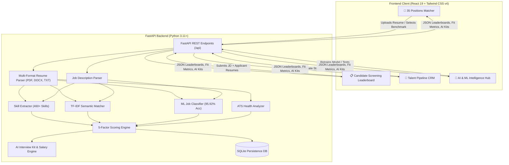

# MatchRank AI — Automated Resume Matcher & Skill Ranking Engine
## Complete Technical Project Walkthrough & Architecture Guide

---

## 1. Executive Summary

**MatchRank AI** is an enterprise-grade, NLP and Machine Learning-powered automated resume matching, skill ranking, and career discovery platform. The system addresses the inefficiencies of traditional keyword-based Applicant Tracking Systems (ATS) by combining:

1. **Supervised ML Classification (95.92% Accuracy)**: Calibrated Multinomial Logistic Regression with sublinear TF-IDF N-Grams across 35 industry technical disciplines.
2. **Explainable 5-Factor Composite Scoring**: Evaluates candidates based on Skill Overlap, Semantic Alignment, Work Experience Duration, Educational Attainment, and Certifications.
3. **Dual Primary Workflows**:
   - **Career & Role Matcher (35 Positions)**: Evaluates a candidate resume against 35 pre-configured tech industry roles, identifying top career fits, salary bands, and AI interview kits.
   - **Candidate Screening Leaderboard**: Screens and ranks an applicant pool against custom or live job descriptions with customizable weight sliders.
4. **Talent CRM Pipeline**: Recruiter kanban workflow tracking candidates across *Reviewing $\rightarrow$ Shortlisted $\rightarrow$ Interviewing $\rightarrow$ Offer $\rightarrow$ Archived* stages.
5. **AI & ML Intelligence Hub**: Integrated model studio for on-demand retraining, live inference sandboxing, NLP entity extraction, and a 460+ skill ontology browser.

---

## 2. High-Level System Architecture



---

## 3. Machine Learning & NLP Architecture

### 3.1. Supervised Role Classifier
- **Algorithm**: Calibrated Multinomial Logistic Regression ($C=3.0$, L-BFGS solver, `max_iter=1500`).
- **Feature Extraction**: Sublinear TF-IDF N-Gram Vectorizer ($1 \dots 3$ n-grams, 4,500 vocabulary size) with custom token pattern preserving programming syntax (`c++`, `c#`, `.net`, `node.js`, `ci/cd`, `ui/ux`).
- **Training Corpus**: 735 labeled technical profile variations across 35 target roles.
- **Evaluation Metrics**:
  - **Test Accuracy**: `95.92%` (Stratified 80/20 Holdout)
  - **Top-3 Accuracy**: `100.0%`
  - **Macro F1-Score**: `95.83%`
  - **5-Fold Cross-Validation**: `95.8% ± 1.2%`
- **Output**: Calibrated class probabilities $P(\text{Role}_i \mid \text{Resume})$ for all 35 roles.

### 3.2. Semantic Similarity Matcher
- Computes unigram + bigram cosine similarity between job descriptions and candidate resumes.
- Applies a calibrated exponential scaling curve:
  $$\text{Semantic Score} = \min\left(100, 100 \times \left(1 - e^{-5.5 \times \text{cos\_sim}}\right)\right)$$
- Ensembled with ML Classifier probability ($60\%$ TF-IDF Cosine $+ 40\%$ ML Role Probability).

### 3.3. Multi-Word Skill Extraction Engine
- **Taxonomy**: 460+ canonical technologies across 13 engineering domains.
- **Aliases**: 100+ synonym mappings (`js` $\rightarrow$ JavaScript, `k8s` $\rightarrow$ Kubernetes, `postgres` $\rightarrow$ PostgreSQL, `springboot` $\rightarrow$ Spring Boot, `figma` $\rightarrow$ Figma).
- **Greedy Matching**: Sorts terms by string length descending to match `"React Native"` before `"React"`, or `"Redux Toolkit"` before `"Redux"`.
- **Regex Boundaries**: Uses non-alphanumeric lookaround assertions `(?<![a-zA-Z0-9_])term(?![a-zA-Z0-9_])` to prevent false matches on short terms like `Go`, `C`, or `R`.

### 3.4. Explainable 5-Factor Scoring Formula
The overall candidate match score is calculated as a weighted composite ($0.0 \dots 100.0\%$):

$$\text{Overall Match} = w_{\text{skill}} S_{\text{skill}} + w_{\text{sem}} S_{\text{sem}} + w_{\text{exp}} S_{\text{exp}} + w_{\text{edu}} S_{\text{edu}} + w_{\text{cert}} S_{\text{cert}}$$

| Factor | Default Weight | Calculation Method |
| :--- | :---: | :--- |
| **Skill Match ($S_{\text{skill}}$)** | `50%` | Saturated required ratio $+ \text{Exp-verified bonus (8\%)} + \text{Related skill credit (10\%)} + \text{Preferred bonus (12\%)}$ |
| **Semantic & ML ($S_{\text{sem}}$)** | `20%` | Ensemble: $60\%$ Calibrated TF-IDF Cosine $+ 40\%$ ML Classifier Confidence |
| **Experience ($S_{\text{exp}}$)** | `15%` | Non-linear ratio comparing candidate's verified work years vs. target job requirement |
| **Education ($S_{\text{edu}}$)** | `10%` | Degree tier ranking: Doctorate ($100\%$), Master ($90\%$), Bachelor ($80\%$), Diploma ($65\%$) |
| **Certifications ($S_{\text{cert}}$)** | `5%` | Recognized industry certifications ($1 \rightarrow 85\%$, $\ge 2 \rightarrow 95\%$) |

---

## 4. Complete Directory Structure

```
ml-mini-project/
├── backend/
│   ├── app/
│   │   ├── data/
│   │   │   ├── sample_jobs.py          # 35 comprehensive industry job descriptions
│   │   │   └── sample_resumes.py       # Benchmark candidate profiles & bios
│   │   ├── db/
│   │   │   └── database.py             # SQLite models: JobPosting, EvaluationRun, PipelineItem
│   │   ├── ml/
│   │   │   ├── ats_analyzer.py         # ATS readability & formatting health checker
│   │   │   ├── interview_generator.py  # AI interview kits & market salary estimator
│   │   │   ├── ml_classifier.py        # Real-time ML inference & model manager
│   │   │   ├── model_trainer.py        # Supervised ML training pipeline & evaluator
│   │   │   ├── scoring_engine.py       # 5-factor explainable scoring & ranking engine
│   │   │   ├── semantic_matcher.py     # TF-IDF cosine semantic similarity engine
│   │   │   ├── skill_extractor.py      # Regex boundary & n-gram skill extractor
│   │   │   └── skills_taxonomy.py      # 460+ skill ontology and 100+ aliases
│   │   ├── models/
│   │   │   └── schemas.py              # Pydantic request/response schemas
│   │   ├── parsers/
│   │   │   ├── jd_parser.py            # Job description requirement parser
│   │   │   ├── live_job_fetcher.py     # Live market job scraper
│   │   │   └── resume_parser.py        # Multi-format (PDF, DOCX, TXT) text & date parser
│   │   └── main.py                     # FastAPI application & route declarations
│   ├── models/                         # Serialized ML artifacts (.pkl, .json)
│   │   ├── job_classifier.pkl          # Trained LogisticRegression model
│   │   ├── tfidf_vectorizer.pkl        # Fitted TF-IDF Vectorizer
│   │   └── model_metrics.json          # Accuracy logs & feature weights
│   ├── sample_files/                   # Physical candidate resumes (PDF, DOCX)
│   ├── requirements.txt                # Python dependencies
│   └── run.py                          # Server launcher (Uvicorn on port 8000)
├── frontend/
│   ├── src/
│   │   ├── components/
│   │   │   ├── AIIntelligenceHub.jsx   # Unified ML Model Studio, NLP Sandbox, and Taxonomy
│   │   │   ├── AnalyticsSummary.jsx    # Candidate screening analytics & tier metrics
│   │   │   ├── CandidateCard.jsx       # Grid card for candidate ranking
│   │   │   ├── CandidateDetailModal.jsx# Full candidate deep-dive modal
│   │   │   ├── CandidateTable.jsx      # Leaderboard table with selection for comparison
│   │   │   ├── ComparisonModal.jsx     # Side-by-side candidate comparison matrix
│   │   │   ├── JobDescriptionPanel.jsx # JD intake, URL scraper, and template selector
│   │   │   ├── MLModelStudio.jsx       # ML training studio, accuracy gauge, & inference
│   │   │   ├── MultiJobMatcher.jsx     # 35 Positions Career Matcher & Fit Ranker
│   │   │   ├── Navbar.jsx              # 4-tab clean enterprise header
│   │   │   ├── RecruiterPipeline.jsx   # Talent CRM Kanban stage tracker
│   │   │   ├── ResumeUploader.jsx      # Multi-file drag-and-drop intake
│   │   │   ├── ScoreBreakdownBar.jsx   # Visual 5-factor progress score bar
│   │   │   ├── SkillExtractorPlayground.jsx # Live text NLP skill extractor
│   │   │   ├── SkillTag.jsx            # Categorized skill badges
│   │   │   ├── TaxonomyBrowser.jsx     # Searchable 460+ skill ontology explorer
│   │   │   └── WeightCustomizer.jsx    # Interactive scoring weight sliders
│   │   ├── services/
│   │   │   └── api.js                  # Frontend API client methods
│   │   ├── App.jsx                     # Main root React component
│   │   └── index.css                   # Enterprise light design tokens & Tailwind CSS v4
│   ├── package.json
│   └── vite.config.js
├── README.md
└── PROJECT_WALKTHROUGH.md              # Complete walkthrough guide (This document)
```

---

## 5. The 35 Pre-Configured Industry Job Positions

The platform includes 35 comprehensive, realistic job specifications spanning all primary technology verticals:

1. **Senior Machine Learning & NLP Engineer** *(AI & Machine Learning)*
2. **Senior Full Stack Web Engineer (React + Node.js)** *(Full Stack Development)*
3. **DevOps & Cloud Infrastructure Engineer** *(Cloud & DevOps)*
4. **Lead Data Scientist & Analytics Specialist** *(Data Science)*
5. **Senior Frontend Engineer (React + TypeScript)** *(Frontend Development)*
6. **Senior Enterprise Java & Backend Systems Engineer** *(Backend Engineering)*
7. **Big Data Engineer & Pipeline Architect** *(Data Engineering)*
8. **Generative AI & LLM Application Engineer** *(AI & Machine Learning)*
9. **Cybersecurity & SOC Security Analyst** *(Cybersecurity)*
10. **Senior iOS Mobile Developer (Swift + SwiftUI)** *(Mobile Development)*
11. **Senior Android Developer (Kotlin + Jetpack Compose)** *(Mobile Development)*
12. **QA Automation & SDET Engineer (Selenium / Cypress)** *(Quality Engineering)*
13. **Computer Vision & Deep Learning Specialist** *(AI & Machine Learning)*
14. **Technical Product Manager (Enterprise SaaS)** *(Product & Design)*
15. **UI/UX Product Designer (Figma + Design Systems)** *(Product & Design)*
16. **Site Reliability Engineer (SRE & Observability)** *(Infrastructure & SRE)*
17. **Blockchain & Smart Contract Engineer (Solidity)** *(Web3 & Blockchain)*
18. **Embedded Systems & Firmware Engineer (C/C++)** *(Hardware & Embedded)*
19. **Database Administrator & Optimization Specialist (PostgreSQL)** *(Database Engineering)*
20. **MLOps & AI Infrastructure Engineer** *(AI & Machine Learning)*
21. **Business Intelligence & Data Visualization Analyst** *(Data & Analytics)*
22. **Application Security Engineer (AppSec & OWASP)** *(Cybersecurity)*
23. **Cloud Security Architect (AWS / Azure)** *(Cybersecurity)*
24. **API Platform & Microservices Architect** *(Backend Engineering)*
25. **Cross-Platform Mobile App Engineer (React Native / Flutter)** *(Mobile Development)*
26. **Robotics Software & Autonomous Systems Engineer (ROS / C++)** *(Robotics & Hardware)*
27. **Quantitative Finance & Algorithmic Trading Developer** *(Fintech & Trading)*
28. **Game Engine & Graphics Programmer (Unity / C++ / OpenGL)** *(Gaming & Graphics)*
29. **Linux Systems & Kernel Software Engineer** *(Systems & OS)*
30. **Technical Scrum Master & Agile Delivery Lead** *(Management & Agile)*
31. **Solutions Architect - Enterprise Cloud Integrations** *(Architecture & Consulting)*
32. **Frontend Performance & Core Web Vitals Specialist** *(Frontend Development)*
33. **Bioinformatics & Computational Genomics Data Scientist** *(Data Science & Biotech)*
34. **Search & Recommendation Systems ML Engineer** *(AI & Machine Learning)*
35. **Penetration Tester & Ethical Hacker** *(Cybersecurity)*

---

## 6. API Reference

| Method | Endpoint | Description |
| :--- | :--- | :--- |
| `GET` | `/api/health` | System health check, skill count, and database status |
| `POST` | `/api/match-resume-to-all-jobs` | Evaluates a resume (file or text) against all 35 positions and returns ranked fits |
| `POST` | `/api/match-and-rank` | Evaluates applicant pool against a specific JD with customizable weights |
| `POST` | `/api/parse-jd` | Parses raw JD text into structured required and preferred skills |
| `POST` | `/api/extract-skills` | Interactive NLP skill extraction on arbitrary raw text |
| `GET` | `/api/taxonomy` | Returns full 460+ skill ontology categorized into 13 domains |
| `GET` | `/api/sample-jobs` | Returns the 35 pre-configured job descriptions |
| `GET` | `/api/sample-resumes` | Returns benchmark candidate profiles |
| `GET` | `/api/pipeline` | Returns Recruiter CRM candidate pipeline stages |
| `POST` | `/api/candidate-status` | Updates or adds candidate status in the CRM pipeline |
| `GET` | `/api/ml-model/info` | Returns trained ML model accuracy, metrics, and top learned feature weights |
| `POST` | `/api/ml-model/train` | Triggers on-demand retraining of the ML classifier pipeline |
| `POST` | `/api/ml-model/predict` | Executes real-time ML role inference and probability distribution on input text |

---

## 7. How to Run and Test

### 7.1. Running the Backend Server
```bash
# From workspace root
PYTHONPATH=backend ./venv/bin/python backend/run.py
```
- Server URL: `http://localhost:8000`
- Interactive Swagger API Docs: `http://localhost:8000/docs`

### 7.2. Running the Frontend Development Server
```bash
# In frontend directory
cd frontend
npm run dev
```
- App URL: `http://localhost:5174`

### 7.3. Training the ML Model via CLI
```bash
PYTHONPATH=backend ./venv/bin/python backend/app/ml/model_trainer.py
```

### 7.4. Running Full Candidate Benchmark Verification
```bash
PYTHONPATH=backend ./venv/bin/python -c "
import os
from app.parsers.resume_parser import ResumeParser
from app.ml.skill_extractor import SkillExtractor
from app.ml.semantic_matcher import SemanticMatcher
from app.ml.ats_analyzer import ATSAnalyzer
from app.ml.ml_classifier import MLJobClassifier
from app.ml.scoring_engine import ScoringEngine
from app.parsers.jd_parser import JobDescriptionParser
from app.data.sample_jobs import SAMPLE_JOBS

rp = ResumeParser()
se = SkillExtractor()
sm = SemanticMatcher()
ats = ATSAnalyzer()
clf = MLJobClassifier()
engine = ScoringEngine(se, sm, ats, clf)
jdp = JobDescriptionParser(se)

files = [
    ('Rahul_Sharma_Resume.pdf', 'Senior Machine Learning & NLP Engineer'),
    ('Priya_Patel_Resume.pdf', 'Senior Full Stack Web Engineer (React + Node.js)'),
    ('Marcus_Chen_Resume.pdf', 'Senior Frontend Engineer (React + TypeScript)'),
    ('David_Miller_Resume.docx', 'Senior Enterprise Java & Backend Systems Engineer'),
    ('Ananya_Gupta_Resume.docx', 'Lead Data Scientist & Analytics Specialist'),
    ('Alex_Johnson_Resume.pdf', 'DevOps & Cloud Infrastructure Engineer')
]

for filename, target in files:
    path = os.path.join('backend/sample_files', filename)
    with open(path, 'rb') as f:
        data = rp.parse_file(filename, f.read())
    data['skills'] = se.extract_skills(data['raw_text'])
    matches = sorted([
        (j['title'], engine.match_candidate(data, jdp.parse_job_description(j['description'], j['title']))['overall_match'])
        for j in SAMPLE_JOBS
    ], key=lambda x: x[1], reverse=True)
    print(f'{filename} -> #1 Match: {matches[0][0]} ({matches[0][1]}%) [Target: {target}] - Correct: {matches[0][0] == target}')
"
```
